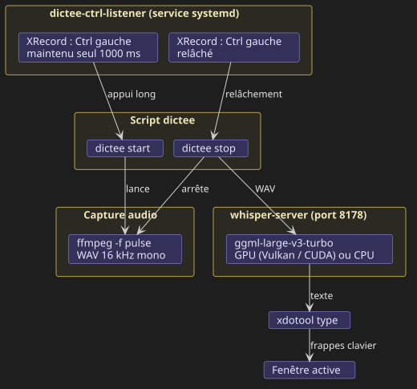

# Dictée vocale locale avec whisper.cpp

## 1. Principe général

*(1.1)* **Le but est de remplacer le clavier par la voix, dans n'importe quelle application, sans envoyer l'audio à un service externe.** On maintient Ctrl gauche, on parle, on relâche, et le texte transcrit est tapé à l'endroit du curseur. Tout tourne en local : la reconnaissance vocale est assurée par whisper.cpp, le modèle Whisper d'OpenAI réimplémenté en C++ sur ggml, qui peut s'exécuter sur CPU ou sur GPU.

*(1.2)* **Le script `dictee` orchestre trois outils existants : ffmpeg capture le micro, whisper-server transcrit, xdotool tape le résultat.** Le serveur whisper reste chargé en mémoire entre deux dictées, ce qui évite de recharger le modèle à chaque phrase. Le script expose deux actions, `start` et `stop`, ainsi qu'un mode `toggle` pour un usage au raccourci clavier.

*(1.3)* **Le geste est un push-to-talk sur Ctrl gauche : on maintient la touche pour parler, on relâche pour que le texte soit tapé.** Un service systemd utilisateur fait tourner `dictee-ctrl-listener`, qui lance la capture dès que Ctrl gauche est maintenu seul pendant une seconde, puis l'arrête et déclenche la transcription au relâchement. Un Ctrl+C ou Ctrl+V classique n'est jamais confondu avec ce geste.



## 2. Prérequis

*(2.1)* **Une session X11 est nécessaire, pour l'injection clavier comme pour l'écoute de Ctrl.** Sous X11, `xdotool type` envoie des frappes à la fenêtre qui a le focus, quelle que soit l'application, et l'extension XRecord permet d'observer le clavier sans privilège. Sous Wayland il faudrait `ydotool` avec un daemon ayant accès à `/dev/uinput`, et un écouteur réécrit sur `evdev` : ce n'est pas couvert ici.

*(2.2)* **Le modèle recommandé est `large-v3-turbo`, qui donne la meilleure qualité en français pour un coût raisonnable.** C'est une version distillée de `large-v3` : même encodeur, décodeur réduit de 32 à 4 couches. Il occupe environ 1,6 Go en mémoire. Sur un CPU moderne il fonctionne, mais un GPU rend la transcription quasi instantanée. Les modèles `medium` et `small` sont des alternatives plus légères, au prix d'une qualité en baisse sur le français.

*(2.3)* **Le GPU est utilisé via le backend que whisper.cpp sait compiler pour votre carte.** Vulkan convient aux GPU AMD et Intel avec les pilotes libres, CUDA aux cartes NVIDIA. Sans GPU, la compilation par défaut utilise le CPU.

*(2.4)* **Les paquets système requis sont ffmpeg, xdotool, python3-xlib, curl, ainsi que les en-têtes du backend GPU choisi.** Pour Vulkan sur Debian/Ubuntu :

```sh
sudo apt install ffmpeg xdotool python3-xlib curl
sudo apt install libvulkan-dev glslc spirv-headers    # backend Vulkan
sudo apt install libsdl2-dev                          # optionnel, pour whisper-stream (test du micro)
```

## 3. Installation

*(3.1)* **whisper.cpp se compile depuis les sources, dans le dossier attendu par le script.** Le script cherche par défaut le dépôt dans `~/vendor/whisper.cpp` ; un autre emplacement se déclare avec la variable `WHISPER_DIR`. La compilation produit `whisper-server` dans `build/bin/`.

```sh
git clone https://github.com/ggml-org/whisper.cpp ~/vendor/whisper.cpp
cd ~/vendor/whisper.cpp
cmake -B build -DGGML_VULKAN=ON -DCMAKE_BUILD_TYPE=Release   # ou -DGGML_CUDA=ON, ou rien pour le CPU
cmake --build build -j"$(nproc)"
./models/download-ggml-model.sh large-v3-turbo
```

*(3.2)* **Le test du micro se fait avec `whisper-stream`, si SDL2 a été activé à la compilation.** Ajouter `-DWHISPER_SDL2=ON` à la commande cmake. On parle, et la transcription s'affiche par fenêtres de quelques secondes.

```sh
./build/bin/whisper-stream -m models/ggml-large-v3-turbo.bin -l fr --step 3000 --length 10000 -t 8
```

*(3.3)* **Les deux scripts sont rendus accessibles dans `~/.local/bin` par des liens symboliques.** Le dépôt peut être cloné n'importe où : l'écouteur Ctrl et le service systemd ne connaissent que ces deux chemins.

```sh
git clone https://github.com/AlexandreBrach/dictee
cd dictee
ln -sf "$PWD/dictee" "$PWD/dictee-ctrl-listener" ~/.local/bin/
```

*(3.4)* **Un premier test en ligne de commande valide la chaîne complète.** Un appel `dictee toggle` lance la capture, on parle quelques secondes, un second appel l'arrête : la phrase est transcrite puis tapée dans le terminal.

*(3.5)* **Le service systemd utilisateur `dictee-ctrl.service` lance l'écouteur à l'ouverture de session et le relance s'il plante.** Il est rattaché à `graphical-session.target` et lance `~/.local/bin/dictee-ctrl-listener`.

```sh
ln -sf "$PWD/dictee-ctrl.service" ~/.config/systemd/user/dictee-ctrl.service
systemctl --user daemon-reload
systemctl --user enable --now dictee-ctrl.service
```

## 4. Le script `dictee`

*(4.1)* **L'état est conservé dans `$XDG_RUNTIME_DIR/dictee/`, un dossier volatile propre à la session.** On y trouve le PID de l'enregistrement en cours, celui du serveur, le dernier WAV et le journal `dictee.log` qui garde l'historique des phrases dictées.

*(4.2)* **Au démarrage de la capture, le script lance ffmpeg sur la source PulseAudio par défaut et démarre le serveur en parallèle.** Le WAV est produit directement au format attendu par Whisper (16 kHz, mono, PCM 16 bits). Comme le serveur se charge pendant que l'utilisateur parle, la première dictée ne subit pas le délai de chargement du modèle.

*(4.3)* **À l'arrêt, le script termine ffmpeg proprement, envoie le WAV au serveur et nettoie le texte avant de le taper.** L'arrêt par SIGINT laisse ffmpeg finaliser l'en-tête WAV. La requête HTTP demande `response_format=text`, `no_timestamps=true` et `temperature=0.0`, pour une transcription déterministe. Le nettoyage retire les retours à la ligne, les espaces en double, et les segments entre crochets ou parenthèses qui correspondent aux hallucinations du type « [Musique] ». Un espace final est ajouté pour pouvoir enchaîner les phrases.

*(4.4)* **Le serveur s'arrête tout seul après dix minutes sans dictée, pour libérer la mémoire.** Après chaque transcription, le script programme l'arrêt du serveur avec un minuteur transitoire systemd : `systemd-run --user --on-active=10min --unit=dictee-idle dictee kill-server`. C'est le même mécanisme qu'un `at`, mais géré par systemd utilisateur et visible dans `systemctl --user list-timers`. La dictée suivante arrête ce minuteur et en crée un nouveau, de sorte que le compte à rebours repart de zéro à chaque usage. Le timer est créé avec `AccuracySec=1s`, car systemd regroupe par défaut les réveils dans une fenêtre d'une minute. L'appui long suivant relance le serveur, avec le délai de chargement du modèle. Le délai se règle par `DICTEE_IDLE_MIN`, et la valeur 0 désactive l'arrêt automatique.

*(4.5)* **Un son court marque chaque changement d'état, sans notification visuelle.** Au démarrage de la capture, le script joue le son `device-added` du thème freedesktop ; à l'arrêt, le son `device-removed`. Ils sont lus par `paplay` en arrière-plan pour ne pas retarder la capture. Un `kdialog --passivepopup` n'apparaît que sur erreur, quand aucun audio n'a été capturé ou quand le serveur n'a pas démarré après 30 s d'attente. Le détail de chaque étape reste tracé dans `dictee.log`.

*(4.6)* **Les sous-commandes couvrent le cycle de vie du serveur et le diagnostic.**

| Commande | Effet |
|---|---|
| `dictee start` / `dictee stop` | démarre la capture / l'arrête et transcrit (utilisés par l'écouteur Ctrl) |
| `dictee` ou `dictee toggle` | alterne entre les deux états, pour un raccourci clavier classique |
| `dictee server` | lance le serveur sans enregistrer, pour le préchauffer, et arme le minuteur d'inactivité |
| `dictee kill-server` | arrête le serveur et le minuteur, libère la mémoire |
| `dictee status` | affiche l'état de l'enregistrement, du serveur et l'heure d'arrêt prévue |

*(4.7)* **Les variables d'environnement permettent d'ajuster le comportement sans modifier le script.**

| Variable | Défaut | Rôle |
|---|---|---|
| `WHISPER_DIR` | `~/vendor/whisper.cpp` | emplacement du dépôt compilé |
| `WHISPER_MODEL` | `$WHISPER_DIR/models/ggml-large-v3-turbo.bin` | modèle à charger |
| `WHISPER_LANG` | `fr` | langue de la dictée |
| `WHISPER_PORT` | `8178` | port du serveur local |
| `WHISPER_THREADS` | `8` | threads CPU alloués au serveur |
| `DICTEE_SOUND_START` | `freedesktop/stereo/device-added.oga` | son joué au début de la capture, vide pour désactiver |
| `DICTEE_SOUND_STOP` | `freedesktop/stereo/device-removed.oga` | son joué à l'arrêt de la capture, vide pour désactiver |
| `DICTEE_IDLE_MIN` | `10` | minutes d'inactivité avant l'arrêt du serveur, 0 pour désactiver |

## 5. Déclenchement par appui long sur Ctrl gauche

*(5.1)* **Les raccourcis des environnements de bureau ne savent pas déclencher sur une touche modificatrice seule, ni sur un appui long.** Ils n'acceptent qu'une combinaison complète du type `Meta+D`. Pour réagir à Ctrl maintenu, il faut un processus qui observe les événements clavier bruts et mesure la durée d'appui.

*(5.2)* **L'écouteur `dictee-ctrl-listener` s'appuie sur l'extension XRecord du serveur X, accessible sans privilège.** C'est le même mécanisme que celui des enregistreurs de macros sous X11 : le serveur rediffuse à un client les événements clavier de tous les autres clients. La bibliothèque `python3-xlib` donne accès à cette extension. L'alternative par `evdev` aurait demandé d'ajouter l'utilisateur au groupe `input` pour lire `/dev/input`.

*(5.3)* **La capture démarre pendant l'appui, au bout de 1000 ms, et seulement si Ctrl gauche est resté seul.** À l'appui sur Ctrl gauche, un minuteur d'une seconde démarre. Si une autre touche est pressée avant son échéance, le minuteur est annulé : c'est un raccourci classique. Si Ctrl est relâché avant, idem. Sinon le minuteur exécute `dictee start` sans attendre le relâchement, et le son de début de capture signale qu'on peut parler.

*(5.4)* **Le relâchement de Ctrl arrête la capture et lance la transcription.** L'écouteur exécute alors `dictee stop` : ffmpeg est arrêté, le WAV est envoyé au serveur, et le texte est tapé dans la fenêtre active. Une fois la capture lancée, les autres touches pressées pendant l'appui sont ignorées, la capture continue jusqu'au relâchement. Comme Ctrl est relâché avant la frappe, xdotool tape dans un contexte propre ; l'option `--clearmodifiers` reste utile si un autre modificateur est enfoncé à ce moment-là.

*(5.5)* **L'écouteur a ses propres variables, déclarées dans le fichier de service.**

| Variable | Défaut | Rôle |
|---|---|---|
| `DICTEE_HOLD_MS` | `1000` | durée d'appui sur Ctrl gauche avant le début de la capture |
| `DICTEE_COMMAND` | `~/.local/bin/dictee` | chemin du script appelé avec `start` et `stop` |

*(5.6)* **Les commandes utiles pour surveiller ou arrêter l'écouteur passent par systemd.**

| Commande | Effet |
|---|---|
| `systemctl --user status dictee-ctrl` | état du service |
| `journalctl --user -u dictee-ctrl -f` | journal en direct, chaque déclenchement y est tracé |
| `systemctl --user stop dictee-ctrl` | arrêt temporaire |
| `systemctl --user disable --now dictee-ctrl` | désactivation définitive |

*(5.7)* **Un raccourci clavier classique en mode toggle reste possible en complément.** Dans les réglages de raccourcis du bureau, ajouter une commande personnalisée qui lance `dictee`, puis lui attribuer une touche libre. Le même raccourci démarre puis arrête la dictée.

## 6. Limites et pistes

*(6.1)* **Le texte arrive d'un bloc à la fin de la dictée, pas mot à mot.** C'est inhérent à Whisper, qui travaille sur des fenêtres audio complètes. Pour une longue dictée, il vaut mieux couper en phrases.

*(6.2)* **Whisper hallucine parfois sur le silence.** Un « Merci. » ou un « [Musique] » peut apparaître quand rien n'a été dit. Le nettoyage du script retire les segments entre crochets ou parenthèses, mais pas les mots isolés.

*(6.3)* **Pour gagner en réactivité sans GPU, on peut descendre au modèle `medium` ou `small`.** Il suffit de télécharger le modèle et de pointer `WHISPER_MODEL` dessus.

*(6.4)* **Le passage à Wayland casserait à la fois l'injection clavier et l'écoute de Ctrl.** Il faudrait remplacer `xdotool type` par `ydotool type`, et réécrire l'écouteur sur `evdev`, avec le daemon `ydotoold` actif et l'utilisateur dans le groupe `input`.

*(6.5)* **Des outils tout faits existent pour le même besoin.** nerd-dictation, whisper-typer ou Speech Note (KDE) s'appuient aussi sur whisper.cpp. Ce script reste plus court à comprendre et à adapter.
